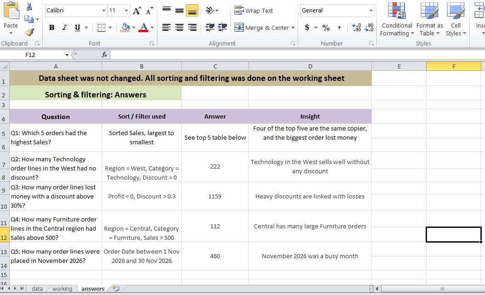
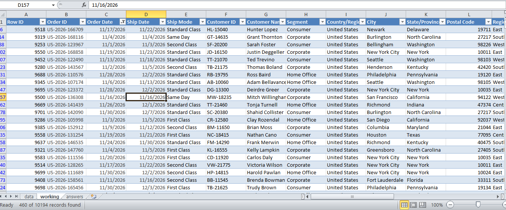

# Basic Data Sorting & Filtering (Excel)

## Overview
Sorting and filtering of the Sample Superstore dataset (10,194 order lines) to
answer 5 simple business questions.

## Workbook structure
- Raw Data: original data, not changed
- Working: a copy used for sorting and filtering
- Answers: the 5 questions, filters used and answers

## Questions and answers
1. Top 5 orders by Sales (sorted Sales, largest to smallest):
   US-2023-145317 (22,638), then four Canon copier orders
2. Technology lines in the West with no discount
   (Region = West, Category = Technology, Discount = 0): 222
3. Lines with a loss and a discount above 30%
   (Profit < 0, Discount > 0.3): 1,159
4. Furniture lines in Central with Sales above 500
   (Region = Central, Category = Furniture, Sales > 500): 112
5. Order lines in November 2026
   (Order Date between 1 Nov and 30 Nov 2026): 460

## Why filter instead of deleting rows
Filtering only hides rows, so no data is lost and the full data returns when
the filter is cleared. Raw data is kept unchanged so results can be checked
against the original.

## Tools Used
Microsoft Excel (Sort, AutoFilter, Number and Date filters)

## Dataset
Sample Superstore Dataset

## Screenshots

